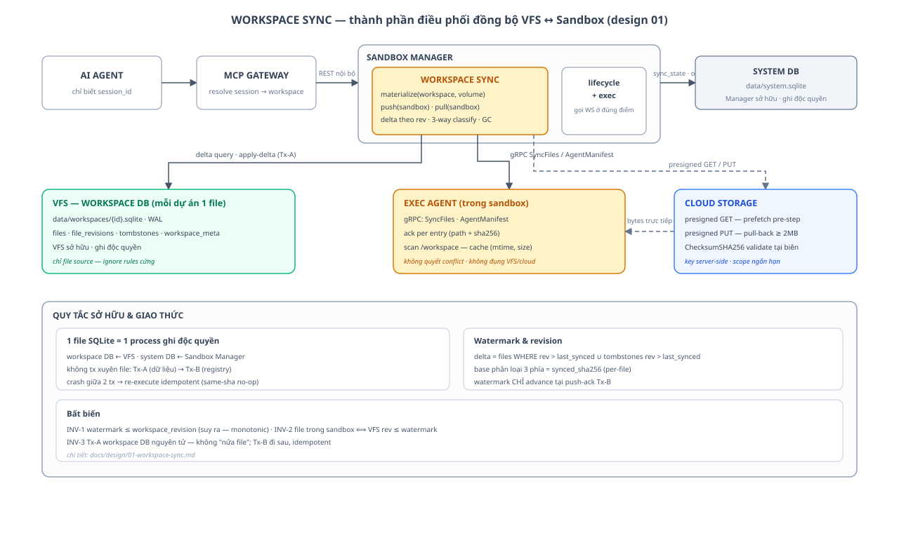
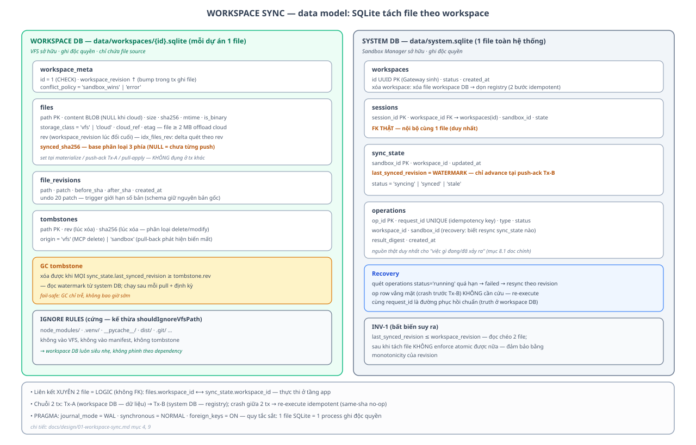
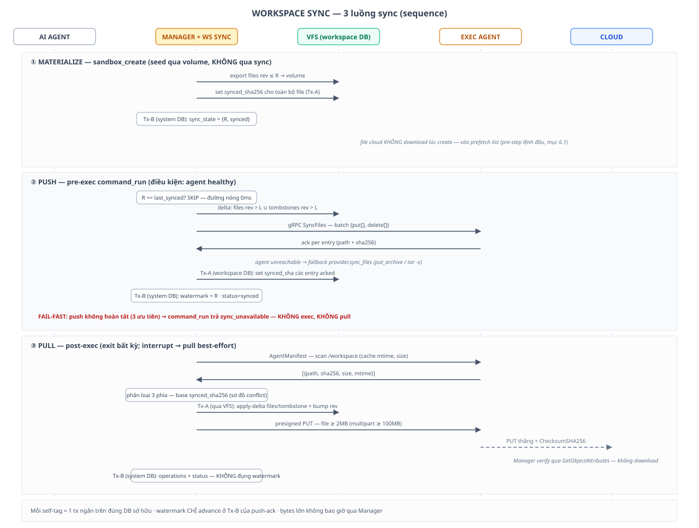
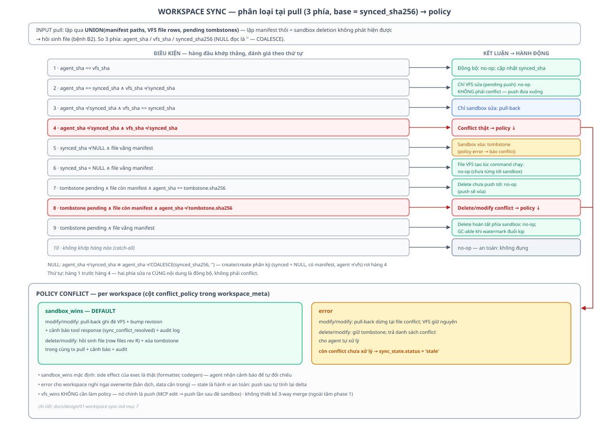

# Design 01 — Workspace Sync: đồng bộ VFS ↔ Sandbox

> **Trạng thái:** Reviewed — Igris PASS-có-điều-kiện, các điều kiện đã đóng (2 vòng review:
> protocol B1/B2 + storage tách file) — **vẫn hợp lệ**; điểm hiệu chỉnh sau đối chiếu kiến
> trúc gốc (2026-11-05): cloud offload → blob sidecar đĩa (C1), revision guard cho write
> (C5), mass-deletion guard ở pull (C7) — xem `../system-design.md` §10 ADR.
> **Phạm vi:** thành phần điều phối đồng bộ VFS ↔ sandbox — data flow, workspace revision,
> conflict detection, tombstone, transaction boundary (SQLite), idempotency.
> **Tham chiếu:** `docs/mcp-integration.md` (mục 3.1 persistence, 4.2, 5.3, 6.3, 8.1);
> `sandbox-kit/docs/vfs_architecture.md`; backlog kiến trúc (P0#1, P0#2, P1#6, P1#9, P1#10).
> **Không thuộc phạm vi:** lifecycle/recovery chi tiết (design 02), security boundary (design 03).
>
> **Sơ đồ (`assets/`):**
> - `design-01-overview.svg` — thành phần & ranh giới sở hữu (2 DB, 4 bên tương tác) — mục 3
> - `design-01-sync-flows.svg` — 3 luồng sync (materialize / push / pull) dạng sequence — mục 6
> - `design-01-conflict.svg` — cây phân loại 10 hàng tại pull + policy — mục 7
> - `design-01-datamodel.svg` — ER 2 DB (workspace DB / system DB) — mục 4

---

## 1. Vấn đề & mục tiêu

Doc kiến trúc hiện mô tả **push** (đưa delta vào sandbox trước khi chạy lệnh, mục 4.2) nhưng
chưa trả lời nửa còn lại của bài toán nhất quán:

| Khoảng trống | Hậu quả nếu không thiết kế |
| :--- | :--- |
| **Không có pull-back** — file sinh ra TRONG sandbox (build artifact, codegen, `npm install` sửa `package-lock.json`) chưa có đường về VFS | Sandbox chết → mất dữ liệu, mâu thuẫn với nguyên tắc "cattle, not pet" (mục 3.1) |
| **Không có workspace revision** | Không biết sandbox "cũ tới đâu", không tính delta rẻ được |
| **Không có conflict detection** | Agent sửa file qua MCP trong lúc command đang chạy → sửa đổi bị ghi đè câm lặng |
| **Không có tombstone** | Xóa file ở một phía, phía kia "hồi sinh" file ở lần sync sau |
| **Trách nhiệm sync rải rác** | Logic nằm trong Manager/lifecycle/tool — không thể test độc lập |

**Mục tiêu:** VFS là SSOT **đúng nghĩa hai chiều** — mọi thay đổi từ sandbox được phản ánh về
VFS; sandbox chết bất cứ lúc nào không mất dữ liệu đã quan sát được.

---

## 2. Nguyên tắc

1. **VFS = SSOT; sandbox = view.** Sandbox chỉ là "máy chiếu" của VFS tại revision R. Mọi thay
   đổi bền vững phải đi qua VFS (trực tiếp qua MCP, hoặc gián tiếp qua pull-back).
2. **Một thành phần điều phối duy nhất.** Toàn bộ logic sync thuộc **Workspace Sync** — module
   tách riêng trong Sandbox Manager (in-process, phase 1). Lifecycle/exec/provider **không tự
   tính delta** — chỉ gọi API của Workspace Sync.
3. **Bytes không qua MCP Gateway** (mục 6.5 doc chính). Push/pull giữa Manager ↔ agent đi gRPC;
   file cloud đi presigned URL thẳng cloud ↔ sandbox.
4. **Mỗi thay đổi file = 1 transaction trong workspace DB; registry = 1 transaction trong
   system DB; không có transaction xuyên hai file** (mục 3.1 doc chính, mục 9).
5. **Sync là idempotent theo revision** — chạy lại cùng delta cho cùng trạng thái → cùng kết quả.

---

## 3. Phân định trách nhiệm (backlog P1#6)



| Thành phần | Trách nhiệm về sync | KHÔNG làm |
| :--- | :--- | :--- |
| **Workspace Sync** | Tính delta, điều phối push/pull, quản lý revision + tombstone + conflict, cập nhật `sync_state` | Không chạm runtime SDK, không chứa lifecycle |
| **VFS** | Sở hữu + ghi độc quyền workspace DB (files/pointer/revisions/tombstone), fuzzy edit, **bump `workspace_revision` trong cùng transaction** | Không biết sandbox tồn tại; không tự sync; không đụng system DB |
| **SandboxProvider** | `prepare_workspace` (cấp volume/claim), `get_dial_target`, `sync_files` (fallback khi agent unreachable) | Không tính delta, không biết revision |
| **Exec Agent** | Thực thi `SyncFiles` (nhận batch push), scan manifest `/workspace` (phục vụ pull), áp dụng deletion | Không quyết định conflict; không nói chuyện VFS/cloud trực tiếp |
| **Sandbox Manager** | Sở hữu + ghi độc quyền system DB (`sync_state`, `operations`); gọi Workspace Sync ở đúng điểm: pre-exec push, post-exec pull, create materialize, recovery resync | Không tự ghi workspace DB (files/revisions) — mọi thay đổi file phải qua VFS |

---

## 4. Data model — SQLite tách file theo workspace

> Sơ đồ: [`design-01-datamodel.svg`](assets/design-01-datamodel.svg) — ER 2 DB + GC + recovery.



**Chốt lưu trữ: mỗi dự án (workspace) MỘT file SQLite riêng** — kế thừa đúng mô hình bản gốc
`data/workspaces/{workspace_id}.sqlite`, cộng MỘT system DB cho registry toàn hệ thống. Quy tắc
sắt: **một file SQLite = một process giữ quyền ghi duy nhất** — workspace DB chỉ VFS ghi,
system DB chỉ Sandbox Manager ghi; hết SQLITE_BUSY storm, hết điểm nghẽn single-writer toàn hệ
thống:

| File | Sở hữu | Chứa |
| :--- | :--- | :--- |
| `data/workspaces/{id}.sqlite` (mỗi workspace 1 file) | VFS | file source + metadata + revisions + tombstone + bộ đếm `workspace_revision` |
| `data/system.sqlite` (1 file) | Sandbox Manager | workspaces registry, session↔sandbox mapping, `sync_state`, `operations` |

**VFS chỉ lưu file source** — ignore rules cứng (mục 8): `node_modules/`, `.venv/`,
`__pycache__/`, `dist/`, `.git/`… không bao giờ vào DB → workspace DB luôn siêu nhẹ, không
phình theo dependency. Topology triển khai (VFS service riêng hay module in-process với
Manager) đều hợp lệ với quy tắc sở hữu trên — chốt ở thiết kế triển khai, miễn mỗi file đúng 1
writer.

```sql
-- ==== WORKSPACE DB: data/workspaces/{id}.sqlite — VFS sở hữu, ghi độc quyền ====
PRAGMA journal_mode = WAL;
PRAGMA synchronous = NORMAL;
PRAGMA foreign_keys = ON;

CREATE TABLE workspace_meta (
  id INTEGER PRIMARY KEY CHECK (id = 1),
  workspace_revision INTEGER NOT NULL DEFAULT 0,  -- đơn điệu tăng, bump trong tx ghi file
  conflict_policy    TEXT NOT NULL DEFAULT 'sandbox_wins'  -- | 'error'
);

CREATE TABLE files (
  path          TEXT PRIMARY KEY,                -- scope trong workspace này
  content       BLOB,                            -- NULL khi storage_class='cloud'
  size          INTEGER NOT NULL,
  sha256        TEXT NOT NULL,
  mtime         TEXT NOT NULL,
  is_binary     INTEGER NOT NULL DEFAULT 0,
  storage_class TEXT NOT NULL DEFAULT 'vfs',     -- 'vfs' | 'cloud' (mục 6.3 doc chính)
  cloud_ref     TEXT,
  etag          TEXT,
  rev           INTEGER NOT NULL,                -- workspace_revision lúc thay đổi cuối
  synced_sha256 TEXT                             -- sha bản sao lần cuối chắc chắn có trong sandbox
                                                -- (NULL = chưa từng push); set tại materialize/push-ack/pull-apply
);
CREATE INDEX idx_files_rev ON files(rev);

-- file_revisions: giữ nguyên schema bản gốc (undo 20 patch, trigger giới hạn số bản)
CREATE TABLE file_revisions (
  id INTEGER PRIMARY KEY AUTOINCREMENT,
  path TEXT NOT NULL, patch TEXT NOT NULL,
  before_sha TEXT NOT NULL, after_sha TEXT NOT NULL, created_at TEXT NOT NULL
);

-- Tombstone (mới): file đã xóa, chưa chắc mọi sandbox đã ack
CREATE TABLE tombstones (
  path   TEXT PRIMARY KEY,
  rev    INTEGER NOT NULL,                       -- revision lúc xóa
  sha256 TEXT NOT NULL,                          -- sha file tại lúc xóa (phân loại delete/modify)
  origin TEXT NOT NULL,                          -- 'vfs' (MCP delete) | 'sandbox' (pull-back)
  cloud_ref TEXT                                 -- để dọn object cloud
);

-- ==== SYSTEM DB: data/system.sqlite — Sandbox Manager sở hữu, ghi độc quyền ====
CREATE TABLE workspaces (
  id TEXT PRIMARY KEY,                           -- UUID, Gateway sinh (mục 12.1 doc chính)
  status TEXT NOT NULL, created_at TEXT NOT NULL
);
CREATE TABLE sessions (
  session_id   TEXT PRIMARY KEY,
  workspace_id TEXT NOT NULL REFERENCES workspaces(id),
  sandbox_id   TEXT, state TEXT NOT NULL         -- mapping session↔sandbox (mục 3.1 doc chính)
);
CREATE TABLE sync_state (
  sandbox_id           TEXT PRIMARY KEY,
  workspace_id         TEXT NOT NULL,
  last_synced_revision INTEGER NOT NULL DEFAULT 0,  -- sandbox đã có đủ tới revision này
  status               TEXT NOT NULL DEFAULT 'syncing', -- syncing | synced | stale
  updated_at           TEXT NOT NULL
);
CREATE TABLE operations (
  op_id TEXT PRIMARY KEY,
  request_id TEXT NOT NULL UNIQUE,               -- idempotency key
  workspace_id TEXT NOT NULL,
  sandbox_id   TEXT,                             -- phục vụ recovery: biết resync sync_state nào
  type TEXT NOT NULL, status TEXT NOT NULL,
  result_digest TEXT,
  created_at TEXT NOT NULL
);
```

**Vì sao tách file theo workspace (không gộp 1 DB duy nhất):** isolation tenant **vật lý** —
xóa workspace = xóa 1 file, giải phóng 100% dung lượng tức thì; hỏng 1 workspace DB không lây
workspace khác; mỗi file là 1 writer domain → không có global write bottleneck. Đánh đổi:
KHÔNG có transaction xuyên hai file — chuỗi "ghi file (workspace DB) → ghi operation (system
DB)" là 2 tx; an toàn vì mọi thao tác sync **idempotent theo revision/sha** (mục 9, 10) — crash
giữa 2 tx chỉ tạo thao tác lặp vô hại, không mất dữ liệu.

---

## 5. Revision model

- **`workspace_revision`** — bộ đếm đơn điệu của workspace, **bump trong cùng transaction** với
  mọi thay đổi (ghi/sửa/xóa file). Không có revision = không có gì đổi.
- **`files.rev`** = `workspace_revision` tại lúc file thay đổi cuối → tính delta là 1 quét index:
  `WHERE rev > :last_synced_revision` — **không cần lưu snapshot manifest** của lần sync trước
  (khác camelAI phải giữ SourceManifest nguyên bản).
- **`sync_state.last_synced_revision`** — mốc "sandbox này đã có đủ tới đâu". **Chỉ advance
  tại push-ack tx** — không bao giờ nhảy ở pull (xem mục 6.3 bước 6).

**Supersedes:** cách diễn đạt "so manifest VFS vs lần sync cuối" (mục 5.3 doc chính) và
`workspace_manifest` = "nguồn cho delta sync" (mục 4.5 doc chính) là mô hình manifest-comparison
cũ — thiết kế này thay bằng delta theo rev watermark; `workspace_manifest` chỉ còn vai trò
quan sát/kiểm chứng.

```text
Các bất biến:
  INV-1  sync_state.last_synced_revision ≤ workspace_meta.workspace_revision (luôn)
         — bất biến SUY RA: đọc chéo 2 file, monotonic revision đảm bảo; sau khi tách file
         không enforce atomic được nữa
  INV-2  file có trong sandbox ⟺ tồn tại trong VFS rev ≤ last_synced_revision
         (như file sống, hoặc tombstone đang chờ ack)
  INV-3  pull-apply: Tx-A (workspace DB) nguyên tử — không "nửa file"; Tx-B (system DB)
         đi sau, idempotent
```

---

## 6. Luồng sync

> Sơ đồ: [`design-01-sync-flows.svg`](assets/design-01-sync-flows.svg) — 3 luồng dạng sequence.



### 6.1. Materialize — sandbox mới (create)

Theo quyết định đã chốt: **seed qua volume mount, KHÔNG đi qua sync** (mục 3.3 doc chính).

```text
sandbox_create → Workspace Sync.materialize(workspace_id, volume):
  1. Export toàn bộ files (rev ≤ current) vào volume/claim  → DONE cho file VFS
  2. File cloud (storage_class='cloud') → KHÔNG download lúc create
     → ghi vào prefetch list của workspace
  3. Set synced_sha256 cho toàn bộ file đã export (workspace DB, ngay lúc materialize)
     → ghi sync_state = {last_synced_revision: R_hiện_tai, status: synced} (system DB)
```

File cloud được prefetch bằng presigned GET trong **pre-step của lệnh đầu tiên** (mục 5.3 doc
chính) — sandbox khởi động tức thì dù workspace có dataset hàng GB. (Tùy chọn profile
`eager_materialize`: download luôn lúc create — đánh đổi latency create.)

### 6.2. Push — trước khi chạy lệnh (pre-exec)

```text
command_run(session_id) → Manager gọi Workspace Sync.push(sandbox_id):
  1. Đọc R = workspace_revision; nếu R == last_synced_revision → SKIP (0ms, đường nóng)
  2. Delta = files WHERE rev > last_synced_revision (bỏ qua entry đã
     synced_sha == sha256 hiện tại — content pull-back vừa ghi) ∪ tombstones WHERE
     rev > last_synced_revision (deletion set)
  3. Vận chuyển theo ưu tiên cố định (mục 4.2 doc chính):
       ưu tiên 1: gRPC SyncFiles(stream) tới exec agent — batch {put[], delete[]}
       ưu tiên 2: provider.sync_files fallback (put_archive / tar -x)
       ưu tiên 3: lỗi sync_unavailable
  4. Agent ack từng entry (path + sha256) → đủ 100%:
       Tx-A (workspace DB, qua VFS): set synced_sha256 cho các entry được ack
       Tx-B (system DB): sync_state.last_synced_revision = R, status = synced
  5. File cloud KHÔNG thuộc delta push → nằm trong pre-step prefetch (mục 6.4)
```

Ack thiếu (agent chết giữa push) → `sync_state.status = stale`, giữ
`last_synced_revision` cũ → lần push sau tự tính lại delta trùng lặp (idempotent, an toàn).

**Fail-fast (chốt): push không hoàn tất qua cả 3 ưu tiên → `command_run` trả
`sync_unavailable` — KHÔNG exec, KHÔNG pull.** Chạy lệnh trên sandbox stale làm mọi phân loại
ở pull méo (false conflict, hồi sinh file); watermark stale phải xử lý trước.

### 6.3. Pull — sau khi lệnh chạy xong (post-exec) — **nửa còn lại của SSOT**

```text
command_run kết thúc (exit code bất kỳ; `command_interrupt` cũng trigger pull best-effort —
không bỏ) → Workspace Sync.pull(sandbox_id):
  1. gRPC AgentManifest → agent scan /workspace (theo ignore rules, mục 8)
     trả [{path, sha256, size, mtime}]. Agent sống dài trong sandbox → cache manifest
     theo (mtime, size), chỉ hash lại file đổi — tránh O(tree) sau MỖI command
     (1GB ≈ vài giây nếu hash lại toàn bộ)
  2. So 3 phía cho từng path: VFS hiện tại vs agent manifest vs bản sao chung
     (`synced_sha256`) — miền lặp union(manifest, VFS rows, pending tombstones)
  3. Phân loại:
     • MỚI trong sandbox (VFS không có)                    → pull-back
     • agent_sha ≠ vfs_sha VÀ vfs.rev ≤ last_synced       → sandbox sửa → pull-back
     • agent_sha ≠ vfs_sha VÀ vfs.rev > last_synced       → CONFLICT (mục 7)
     • có trong mốc push nhưng vắng trong agent manifest   → sandbox xóa → tombstone
     • còn lại                                             → không đổi
  4. Pull-back file nhỏ (< threshold 2 MB): agent stream bytes trong batch tiếp theo
     → Workspace Sync gọi VFS apply-delta → VFS ghi workspace DB (tx: files +
       file_revisions patch + bump revision), trả revision mới
  5. Pull-back file lớn (≥ threshold): Manager cấp presigned PUT (multipart nếu ≥100 MB,
     batch 50–100 part — mục 6.2 doc chính) → agent PUT thẳng cloud → Manager ghi pointer
     qua VFS (tx workspace DB). Bytes lớn KHÔNG qua Manager — đối xứng với nguyên tắc 6.5
     doc chính. Verify sha256 KHÔNG download object (sẽ thành ống bytes): agent set
     additional checksum `ChecksumSHA256` lúc PUT → S3 validate tại biên; Manager đọc
     `GetObjectAttributes` đối chiếu. Object key pull-back do **server sinh** theo quy tắc
     6.2 doc chính (`workspaces/{ws}/files/{uuid}-...`), không bao giờ tin key theo path.
  6. Pull tx chỉ cập nhật synced_sha256 per-file — WATERMARK KHÔNG NHẢY ở pull.
     `last_synced_revision` CHỈ advance tại push-ack tx. Push sau pull sẽ advance:
     bỏ qua entry đã có synced_sha == sha hiện tại (không gửi lại content pull-back
     vừa ghi) và đưa tombstone-origin-sandbox vào delete[] — ack rỗng rẻ, idempotent, hội tụ
```

**Vì sao pull ngay sau mỗi lệnh** (không cron): cửa sổ mất dữ liệu co lại còn ~0 (chỉ rủi ro
sandbox chết GIỮA lệnh — artifact chưa kịp sinh đủ thì vốn chưa complete); chi phí = 1 scan
manifest cục bộ trên disk sandbox (nhanh, có ignore rules).

### 6.4. File cloud trong sync

| Chiều | Xử lý |
| :--- | :--- |
| Push (VFS → sandbox) | Không push bytes — pre-step prefetch presigned GET (mục 5.3 doc chính) |
| Pull (sandbox → VFS) | ≥ threshold → presigned PUT/multipart trực tiếp cloud (6.3 bước 5); ghi pointer sau verify |
| Xóa | Tombstone + batch delete object (kế thừa cleanup mục 6.3 doc chính) |

---

## 7. Conflict detection & resolution

> Sơ đồ: [`design-01-conflict.svg`](assets/design-01-conflict.svg) — cây phân loại 10 hàng + policy.



**Khi nào conflict:** 1 file bị sửa ở CẢ hai phía kể từ bản sao chung (`synced_sha256`) — tức
MCP write xảy ra trong lúc command đang chạy, và command cũng đụng đúng file đó. Đây đúng là
giao điểm với backlog P0#2 (concurrent execution).

**Miền lặp của phân loại = union(manifest paths, VFS file rows, pending tombstones)** — KHÔNG
chỉ lặp manifest paths: sandbox deletion chỉ phát hiện được qua VFS rows / tombstones (hàng 5);
bỏ union là hồi sinh file (đúng bệnh B2).

**Phân loại 3 phía thật sự — base = `synced_sha256`** (sha bản sao lần cuối chắc chắn có trong
sandbox; rev/watermark một mình KHÔNG phân biệt được "sandbox sửa" vs "VFS sửa chưa push" —
phân loại sai kiểu này khiến MCP edit đã ack bị pull-back đè mất, đúng bệnh P0#1):

| Điều kiện tại pull | Kết luận | Hành động |
| :--- | :--- | :--- |
| `agent_sha == vfs_sha` | Đồng bộ | no-op; cập nhật `synced_sha` |
| `agent_sha == synced_sha` ∧ `vfs_sha ≠ synced_sha` | Chỉ VFS sửa (pending push) | **no-op — KHÔNG phải conflict**; push lần sau đưa xuống |
| `agent_sha ≠ synced_sha` ∧ `vfs_sha == synced_sha` | Chỉ sandbox sửa | Pull-back |
| `agent_sha ≠ synced_sha` ∧ `vfs_sha ≠ synced_sha` | **Conflict thật (cả hai sửa)** | Theo policy bên dưới |
| `synced_sha ≠ NULL` ∧ file vắng manifest | Sandbox xóa | Tombstone (policy `error` → báo conflict) |
| `synced_sha = NULL` ∧ file vắng manifest | File tạo ở VFS lúc command chạy | no-op (chưa từng tới sandbox) |
| Tombstone pending ∧ file còn trong manifest ∧ `agent_sha == tombstone.sha256` | Delete chưa push tới | no-op (push sẽ xóa) |
| Tombstone pending ∧ file còn trong manifest ∧ `agent_sha ≠ tombstone.sha256` | **Delete/modify conflict** | Theo policy bên dưới |
| Tombstone pending ∧ file vắng manifest | Delete đã hoàn tất phía sandbox | no-op; tombstone GC-able khi watermark đuổi kịp |
| Không khớp hàng nào | — | no-op (catch-all — an toàn theo hướng "không đụng") |

**NULL semantics:** so sánh với `NULL` trong SQL không match hàng nào — mọi điều kiện
`agent_sha ≠ synced_sha` đọc là `agent_sha ≠ COALESCE(synced_sha256, '')`. Case
create/create phân kỳ (`synced_sha = NULL`, có trong manifest, `agent_sha ≠ vfs_sha`) rơi vào
hàng 4 (conflict) — đúng nghĩa: VFS tạo lúc command chạy, sandbox cũng tạo khác nội dung.

**Thứ tự đánh giá:** các hàng áp theo thứ tự trong bảng, hàng đầu khớp thắng (hàng 1 trước
hàng 4 — hai phía sửa ra CÙNG nội dung là đồng bộ, không phải conflict).

**Policy (per workspace, cột `conflict_policy`):**

| Giá trị | Xử lý modify/modify | Xử lý delete/modify |
| :--- | :--- | :--- |
| `sandbox_wins` (**default**) | Pull-back ghi đè VFS + bump revision + **cảnh báo tool response** (`sync_conflict_resolved`) + audit log | Hồi sinh file (row `files` rev R) + **xóa tombstone trong cùng tx pull** + cảnh báo + audit |
| `error` | Pull-back dừng tại file conflict; VFS giữ nguyên | Giữ tombstone; trả danh sách conflict cho agent tự xử lý |

`sandbox_wins` là mặc định vì side effect của exec là thật (formatter, codegen) và agent nhận
cảnh báo để tự đối chiếu; `error` dùng cho workspace nghi ngại overwrite (bản dịch, data cẩn
trọng). Khi còn conflict chưa xử lý (policy `error`), pull flip `sync_state.status = 'stale'` —
push sau tự tính lại delta thay vì tin trạng thái `synced`; lệch dai dẳng chỉ xảy ra nếu agent
bỏ qua báo cáo conflict, và khi đó stale là hành vi an toàn. Lưu ý: `vfs_wins` **không cần**
làm policy — nó chính là push (MCP edit → push lần sau đè lên sandbox). Không thiết kế 3 chiều
merge — ngoài tầm phase 1.

---

## 8. Tombstone

- **Nguồn gốc 'vfs':** MCP `file_delete` → tx { xóa row files + ghi tombstone + bump revision }.
  Push chuyển `delete[]` xuống agent. File cloud kèm `cloud_ref` để batch delete object.
- **Nguồn gốc 'sandbox':** pull phát hiện file đã push biến mất trong agent manifest → tombstone
  cùng tx pull (origin='sandbox', không cần ghi file_revisions).
- **GC:** tombstone xóa được khi **mọi** `sync_state` của workspace có
  `last_synced_revision ≥ tombstone.rev` (đã ack hết) — chạy sau mỗi pull + định kỳ.
- Chống "hồi sinh": push chỉ tính file `rev > last_synced`; file đã xóa không còn row → không
  bao giờ bị đẩy lại. Pull chỉ nhận file MỚI nếu VFS không có tombstone mới hơn.

**VFS chỉ lưu file source — ignore rules cứng (kế thừa `shouldIgnoreVfsPath` bản gốc):**
`node_modules/`, `__pycache__/`, `.venv/`, `dist/`, `.git/`… — **không bao giờ** vào VFS,
không vào manifest, không tombstone. `.git` thuộc Git remote (doctrine 3 tầng của VFS gốc),
không bao giờ đồng bộ.

**`file_move` = tombstone(path cũ) + create(path mới) trong 1 transaction** + bump revision —
rename thuần không tombstone sẽ để path cũ "hồi sinh" qua pull. Pull xử lý 2 path độc lập theo
bảng phân loại mục 7.

---

## 9. Transaction boundary & atomicity (backlog P1#9)

| Operation | Chuỗi transaction (mỗi tx = 1 file DB, `BEGIN IMMEDIATE`) |
| :--- | :--- |
| MCP write/edit | **Tx-A** (workspace DB): files upsert + file_revisions patch + bump revision → **Tx-B** (system DB): operations. Thứ tự cố định dữ-liệu-trước-operation; crash giữa 2 tx → op chưa ghi → retry an toàn (ghi file idempotent theo sha) |
| MCP delete | **Tx-A** (workspace DB): xóa files + tombstone + bump revision → **Tx-B**: operations |
| Push ack | **Tx-A** (workspace DB, qua VFS): cập nhật `synced_sha256` cho các entry được ack → **Tx-B** (system DB): watermark + operations — ngắn, sau khi ack đủ, không giữ tx qua gRPC |
| Pull-apply | **Tx-A** (workspace DB, qua VFS): files upsert/tombstone + file_revisions + bump revision → **Tx-B** (system DB): operations + cột `status` của sync_state. KHÔNG đụng `last_synced_revision` (watermark chỉ advance ở push-ack — chống B2) |
| Presign/verify cloud | Tx₁ (workspace DB) ghi pointer `pending` → network verify → Tx₂ flip `verified` (kế thừa mục 6.4 doc chính: pointer chưa verified = file không tồn tại) |

**Quy tắc sắt:** không bao giờ giữ transaction qua network I/O (gRPC stream, presigned upload).
Mọi bước mạng đặt GIỮA hai tx ngắn; trạng thái trung gian nằm trong `operations`/`sync_state`,
không nằm trong bộ nhớ process → Manager crash bất cứ lúc nào cũng khôi phục được bằng cách
quét `operations` (`status='running'` quá hạn → đánh dấu failed → resync theo revision).

**Same-sha no-op:** upsert với sha256 không đổi → no-op tuyệt đối (không bump revision, không
ghi file_revisions) — retry MCP write không làm nhiễu lịch sử undo. **Op row vắng mặt** (crash
trước Tx-B) KHÔNG phải trạng thái cần cứu — recovery scan không tìm thấy gì; re-execute với
cùng `request_id` là đường phục hồi chuẩn (truth nằm ở workspace DB, vô trạng thái).

---

## 10. Idempotency & retry (cặp với mục 8.1 doc chính)

- Mỗi sync op mang `request_id` (Gateway sinh) → bảng `operations`. Retry cùng key: `done` →
  trả kết quả cũ, không thực thi lại; **`failed` → cho phép re-execute** cùng request_id
  (bổ sung cho quy tắc mục 8.1 doc chính); `running` → `operation_in_progress`.
- **Idempotent tự nhiên theo revision:** apply cùng delta 2 lần → cùng kết quả (upsert theo
  `(path, sha256)` trong workspace DB; tombstone theo path; `rev` không giảm ngược; same-sha
  → no-op). Push trùng batch → agent ghi đè cùng nội dung, vô hại.
- Recovery sau sandbox chết: provision sandbox mới → `materialize` từ VFS + delta mọi thay đổi
  kể từ `last_synced_revision` của sandbox CŨ (mục 8 doc chính) — giữ nguyên `session_id`.

---

## 11. Tương tác concurrent execution (giao design 02)

- **Per-workspace execution lock:** 1 command_run giữ lock; command_run thứ hai → xếp hàng
  (queue) hoặc từ chối `operation_in_progress` (chọn ở design 02 — lifecycle).
- MCP file write DÙNG lệnh command đang chạy: **cho phép** (ghi VFS là SSOT) — conflict
  detection ở pull xử lý hậu quả; `conflict_policy` quyết định kết quả. Đây là lý do policy
  default là `sandbox_wins` + cảnh báo, không phải `error`: workflow agent không bị kẹt.

---

## 12. Failure matrix

| Tình huống | Hành vi | Invariant được giữ |
| :--- | :--- | :--- |
| Agent chết giữa push | ack thiếu → `status=stale`, giữ last_synced cũ; push sau tính lại delta trùng | INV-2 |
| Sandbox chết giữa lệnh (trước pull) | Artifact chưa pull = chưa complete → mất được chấp nhận; recovery materialize từ VFS | INV-1 |
| Manager crash giữa push và update sync_state | Khởi động lại: quét operations running quá hạn → failed; push lại theo revision (trùng lặp vô hại) | INV-3 |
| Agent không trả manifest (pull fail) | `status=stale` + cảnh báo tool response; dữ liệu sandbox coi là chưa xác nhận — KHÔNG tự mò file | INV-2 |
| Pull-apply tx fail giữa chừng | Rollback toàn tx; workspace_revision không bump; pull retry toàn phần | INV-3 |
| Tombstone bị GC nhầm | Không thể: GC chỉ chạy khi mọi sync_state ≥ rev | INV-1, INV-2 |
| Xóa workspace (chuỗi 2 file) | Bước 1: xóa file workspace DB; bước 2: dọn registry/sync_state/operations ở system DB — không atomic, cả 2 bước idempotent; orphan file DB sót lại chỉ tốn disk, không lọt vào luồng sync | INV-2 |

---

## 13. Kiểm chứng (conformance — thêm vào bộ test provider/sync)

1. Push đúng delta: sửa N file + xóa M file qua MCP → agent nhận đúng N put + M delete, sha256 khớp.
2. Pull-back: command sinh file mới + sửa file cũ → VFS có đủ, revision tăng đúng số tx.
3. Conflict: MCP write trong lúc command sửa cùng file → policy sandbox_wins ghi đè + cảnh báo; policy error dừng + trả danh sách.
4. Tombstone: xóa ở VFS → sandbox mất file; xóa trong sandbox (`rm`) → VFS có tombstone; GC đúng điều kiện.
5. Idempotency: gọi lại cùng request_id → không thực thi lại; push/pull trùng → kết quả tương đương.
6. Crash-injection: kill Manager giữa push/pull → khôi phục theo revision, không mất/nửa file.
7. File cloud: pull-back file 500MB → presigned PUT trực tiếp, pointer verified, không bytes qua Manager.
8. MCP edit file mà command KHÔNG đụng (pending push lúc pull) → KHÔNG conflict, MCP edit sống
   sót qua push lần sau (`synced_sha256` phân loại đúng — regression cho BLOCKER B1).
9. Sandbox `rm` file đang có pending VFS write/tombstone → KHÔNG hồi sinh; watermark chỉ
   advance tại push-ack (regression cho BLOCKER B2).

---

## 14. Quyết định đã chốt trong thiết kế này

| # | Quyết định | Lý do chính |
| :--- | :--- | :--- |
| 1 | Delta theo `rev` (index quét), **không lưu bảng snapshot manifest** — base 3 phía = `synced_sha256` per-file trên row có sẵn | Rẻ hơn camelAI SourceManifest; vẫn phân biệt đúng "VFS sửa chưa push" vs "sandbox sửa" |
| 2 | Pull ngay sau mỗi lệnh (post-exec), không cron | Cửa sổ mất dữ liệu ~0; scan cục bộ rẻ |
| 3 | Pull-back file lớn đi presigned PUT trực tiếp cloud, verify bằng S3 additional checksum | Đối xứng nguyên tắc "Manager không là ống bytes" |
| 4 | Conflict default `sandbox_wins` + cảnh báo (option `error`); delete/modify có hành vi riêng theo policy | Không kẹt workflow agent; side effect exec là thật |
| 5 | Materialize lazy cho file cloud (prefetch pre-step) | Create tức thì; nhất quán với mục 5.3 |
| 6 | Tombstone GC theo min(last_synced) của mọi sandbox | Chống hồi sinh file; xác định được thời điểm an toàn |
| 7 | Watermark `last_synced_revision` chỉ advance tại push-ack tx; pull chỉ cập nhật `synced_sha256` | Không che mất pending push (bảo vệ INV-2); hội tụ qua push ack rỗng |
| 8 | Storage tách file: 1 SQLite/workspace (VFS sở hữu) + 1 system DB (Manager sở hữu); 1 file = 1 process ghi độc quyền | Isolation vật lý per dự án; xóa workspace = xóa file; hết SQLITE_BUSY; VFS chỉ chứa file source |
